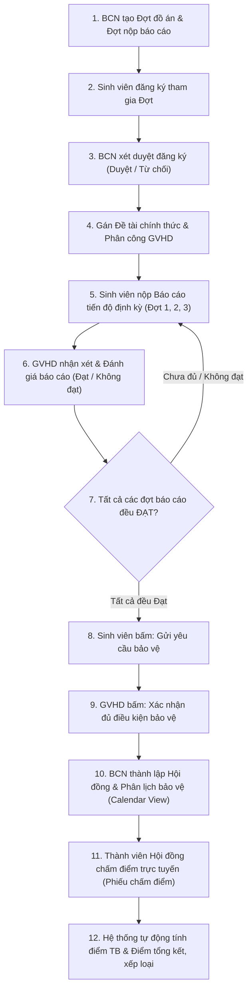

# KỊCH BẢN KIỂM THỬ HỆ THỐNG QUẢN LÝ ĐỒ ÁN TỐT NGHIỆP (`quanly_datn`)

> **Hệ thống:** Quản lý Đồ án Tốt nghiệp cho Khoa Công nghệ số (Odoo 18.0)  
> **Tài liệu kiểm thử:** Kịch bản kiểm thử chức năng & phân quyền nghiệp vụ (Acceptance & Role-Based Test Cases)  
> **Cơ sở dữ liệu:** `datn_db` (Môi trường local: [http://127.0.0.1:8069](http://127.0.0.1:8069))

---

## 1. TÀI KHOẢN DÙNG ĐỂ KIỂM THỬ

Hệ thống đã chuẩn bị sẵn các tài khoản mẫu tương ứng với 3 nhóm vai trò phân quyền:

| Vai trò | Tài khoản đăng nhập (Email) | Mật khẩu | Đại diện nhân sự | Ghi chú quyền hạn |
| :--- | :--- | :--- | :--- | :--- |
| **Ban Chủ nhiệm / Admin** | `admin@ute.udn.vn` | `admin` | Ban Chủ nhiệm Khoa | Toàn quyền quản trị, duyệt đề tài, mở đợt, lập hội đồng, gửi thông báo |
| **Giảng viên hướng dẫn** | `haquyen@ute.udn.vn` | `123456` | ThS. Nguyễn Thị Hà Quyên | Duyệt báo cáo, chấm điểm GVHD, xác nhận đủ điều kiện bảo vệ |
| **Giảng viên Hội đồng** | `levanb@ute.udn.vn` | `123456` | PGS.TS. Lê Văn Bình | Chủ tịch hội đồng, nhập phiếu chấm điểm hội đồng |
| **Sinh viên** | `nhatnam@sv.ute.udn.vn` | `123456` | Phan Hồ Nhật Nam | Sinh viên làm đề tài `DT2026_01`, nộp báo cáo, gửi yêu cầu bảo vệ |
| **Sinh viên khác** | `quanghuy@sv.ute.udn.vn` | `123456` | Nguyễn Quang Huy | Sinh viên làm đề tài `DT2026_02` (kiểm tra ngăn chặn truy cập chéo) |

---

## 2. MA TRẬN LUỒNG NGHIỆP VỤ (WORKFLOW DIAGRAM)

---

## 3. CHI TIẾT BỘ TEST CASE

### Nhóm 1: Cơ cấu Tổ chức & Người dùng

* **Mã nguồn liên quan:** [to_chuc.py](file:///e:/SINHVIENIT/Year4_Ki3/Đồ án/Doc/Project_Odoo/custom_addons/quanly_datn/models/to_chuc.py), [nguoi_dung.py](file:///e:/SINHVIENIT/Year4_Ki3/Đồ án/Doc/Project_Odoo/custom_addons/quanly_datn/models/nguoi_dung.py), [to_chuc_views.xml](file:///e:/SINHVIENIT/Year4_Ki3/Đồ án/Doc/Project_Odoo/custom_addons/quanly_datn/views/to_chuc_views.xml)

| Mã TC | Tên Test Case | Tài khoản test | Các bước thực hiện | Kết quả mong đợi |
| :--- | :--- | :--- | :--- | :--- |
| **TC-ORG-01** | Xem danh mục chuyên ngành và lớp | `admin@ute.udn.vn` | 1. Vào menu **Tổ Chức & Người Dùng** ➔ **Chuyên ngành**. 2. Mở chuyên ngành `KTPM`. | Hiển thị thông tin chuyên ngành, tab danh sách lớp sinh hoạt (`22T1`, `22T2`, `22T3`) và danh sách giảng viên. |
| **TC-ORG-02** | Ràng buộc duy nhất mã lớp | `admin@ute.udn.vn` | 1. Vào **Lớp sinh hoạt** ➔ Bấm **New**. 2. Nhập `Mã lớp`: `22T1` (đã có) ➔ Bấm **Save**. | Hệ thống báo lỗi Validation: Mã lớp đã tồn tại. |
| **TC-ORG-03** | Ràng buộc duy nhất MSSV | `admin@ute.udn.vn` | 1. Vào **Sinh viên** ➔ Tạo sinh viên mới với `Mã SV`: `22115053122323`. | Hệ thống từ chối lưu và hiển thị thông báo lỗi trùng MSSV. |
| **TC-ORG-04** | Tự động điền Chuyên ngành của Sinh viên | `admin@ute.udn.vn` | 1. Tạo hồ sơ sinh viên mới. 2. Chọn `Lớp sinh hoạt` là `22AI`. | Trường `Chuyên ngành` tự động hiển thị `Khoa học máy tính & Trí tuệ nhân tạo` (readonly). |

---

### Nhóm 2: Đợt làm ĐATN & Đăng ký tham gia

* **Mã nguồn liên quan:** [dot_do_an.py](file:///e:/SINHVIENIT/Year4_Ki3/Đồ án/Doc/Project_Odoo/custom_addons/quanly_datn/models/dot_do_an.py), [dot_do_an_views.xml](file:///e:/SINHVIENIT/Year4_Ki3/Đồ án/Doc/Project_Odoo/custom_addons/quanly_datn/views/dot_do_an_views.xml)

| Mã TC | Tên Test Case | Tài khoản test | Các bước thực hiện | Kết quả mong đợi |
| :--- | :--- | :--- | :--- | :--- |
| **TC-DOT-01** | Xem chi tiết Đợt đồ án & Cấu hình trọng số | `admin@ute.udn.vn` | 1. Vào menu **Đợt Đồ Án** ➔ **Đợt làm đồ án**. 2. Mở đợt `DATN_2026_HK2`. | Thấy đầy đủ thông tin: Trọng số GVHD (30%), Báo cáo (20%), Đồ án (50%), Statusbar: `Đang thực hiện`. Các tab liên kết có đủ dữ liệu. |
| **TC-DOT-02** | Sinh viên tự đăng ký khi đợt đang mở | `quanghuy@sv.ute.udn.vn` | 1. Đăng nhập tài khoản sinh viên. 2. Vào **Đợt Đồ Án** ➔ **Danh sách đăng ký** ➔ Tạo đăng ký mới cho đợt đang mở. | Tạo thành công bản ghi đăng ký, trạng thái mặc định là `Chờ duyệt`. |
| **TC-DOT-03** | Chặn sinh viên đăng ký hộ người khác | `nhatnam@sv.ute.udn.vn` | 1. Đăng nhập tài khoản sinh viên A. 2. Cố gắng chọn `sinh_vien_id` là sinh viên B. | Bị chặn bởi logic phân quyền (`AccessError: Bạn chỉ được đăng ký đồ án cho chính mình`). |
| **TC-DOT-04** | BCN duyệt và từ chối đăng ký | `admin@ute.udn.vn` | 1. Vào **Danh sách đăng ký**. 2. Mở bản ghi đang `Chờ duyệt`. 3. Bấm nút **Duyệt đăng ký** hoặc **Từ chối**. | Nút hành động đổi trạng thái sang `Đã duyệt` hoặc `Từ chối`. Sinh viên và Giảng viên không nhìn thấy nút này. |
| **TC-DOT-05** | Duyệt ngân hàng đề tài đề xuất | `admin@ute.udn.vn` | 1. Vào **Ngân hàng đề tài**. 2. Mở đề tài trạng thái `Chờ BCN Khoa duyệt`. 3. Bấm **Duyệt đề tài**. | Đề tài chuyển sang trạng thái `Đã duyệt (Có thể đăng ký)`. |

---

### Nhóm 3: Báo cáo tiến độ định kỳ

* **Mã nguồn liên quan:** [bao_cao.py](file:///e:/SINHVIENIT/Year4_Ki3/Đồ án/Doc/Project_Odoo/custom_addons/quanly_datn/models/bao_cao.py), [bao_cao_views.xml](file:///e:/SINHVIENIT/Year4_Ki3/Đồ án/Doc/Project_Odoo/custom_addons/quanly_datn/views/bao_cao_views.xml)

| Mã TC | Tên Test Case | Tài khoản test | Các bước thực hiện | Kết quả mong đợi |
| :--- | :--- | :--- | :--- | :--- |
| **TC-REP-01** | Sinh viên nộp báo cáo tiến độ | `nhatnam@sv.ute.udn.vn` | 1. Đăng nhập tài khoản sinh viên. 2. Vào **Đề Tài & Tiến Độ** ➔ **Nộp báo cáo tiến độ**. 3. Bấm **New**, chọn Đề tài của mình, chọn Đợt 1, đính kèm tệp PDF ➔ Bấm **Save**. | Nộp thành công bài báo cáo. Trạng thái hiển thị `Đang chờ duyệt`. |
| **TC-REP-02** | Tự động phát hiện nộp trễ hạn | `nhatnam@sv.ute.udn.vn` | 1. Nộp báo cáo cho một đợt có `Hạn nộp` nhỏ hơn ngày hiện tại. | Cột `Nộp trễ hạn` (`nop_tre`) tự động đánh dấu tick đỏ (True). |
| **TC-REP-03** | Chặn sinh viên nộp báo cáo cho đề tài người khác | `quanghuy@sv.ute.udn.vn` | 1. Đăng nhập tài khoản sinh viên Huy. 2. Cố tình chọn đề tài của Nam (`DT2026_01`) để nộp. | Hệ thống từ chối lưu: `AccessError: Bạn chỉ được nộp báo cáo cho đề tài của chính mình`. |
| **TC-REP-04** | GVHD nhận xét và đánh giá báo cáo | `haquyen@ute.udn.vn` | 1. Đăng nhập GVHD. 2. Vào bài nộp của sinh viên hướng dẫn. 3. Nhập nhận xét tại tab `Phản hồi của GVHD`, chọn trạng thái `Đạt yêu cầu` ➔ **Save**. | Lưu thành công đánh giá và nhận xét. |
| **TC-REP-05** | Chặn GV không phải GVHD duyệt báo cáo | `tranvana@ute.udn.vn` | 1. Đăng nhập GV khác (thầy An). 2. Mở bài nộp của đề tài do cô Quyên hướng dẫn (`DT2026_01`). 3. Cố gắng sửa phản hồi / trạng thái. | Bị chặn bởi hệ thống: `AccessError: Chỉ giảng viên hướng dẫn được phản hồi báo cáo`. |

---

### Nhóm 4: Quy trình Điều kiện bảo vệ & Đề tài

* **Mã nguồn liên quan:** [de_tai.py](file:///e:/SINHVIENIT/Year4_Ki3/Đồ án/Doc/Project_Odoo/custom_addons/quanly_datn/models/de_tai.py), [de_tai_views.xml](file:///e:/SINHVIENIT/Year4_Ki3/Đồ án/Doc/Project_Odoo/custom_addons/quanly_datn/views/de_tai_views.xml)

| Mã TC | Tên Test Case | Tài khoản test | Các bước thực hiện | Kết quả mong đợi |
| :--- | :--- | :--- | :--- | :--- |
| **TC-THE-01** | Sinh viên bấm "Gửi yêu cầu bảo vệ" khi CHƯA đủ báo cáo Đạt | `quanghuy@sv.ute.udn.vn` | 1. Đăng nhập sinh viên Huy (đề tài `DT2026_02` mới có báo cáo đợt 1). 2. Mở đề tài `DT2026_02`. 3. Bấm **Gửi yêu cầu bảo vệ**. | Bị chặn và hiển thị thông báo lỗi: `Bạn cần có báo cáo đạt yêu cầu ở tất cả các đợt báo cáo trước khi gửi yêu cầu bảo vệ`. |
| **TC-THE-02** | Sinh viên bấm "Gửi yêu cầu bảo vệ" khi ĐÃ ĐỦ báo cáo Đạt | `thuha@sv.ute.udn.vn` | 1. Mở đề tài `DT2026_03` (đã có đủ 3 đợt đạt yêu cầu). 2. Bấm nút **Gửi yêu cầu bảo vệ**. | Đề tài chuyển thành công sang trạng thái `Chờ GVHD xác nhận bảo vệ`. |
| **TC-THE-03** | GVHD xác nhận đủ điều kiện bảo vệ | `haquyen@ute.udn.vn` | 1. Đăng nhập GVHD. 2. Mở đề tài đang ở trạng thái `Chờ GVHD xác nhận bảo vệ`. 3. Bấm nút **Xác nhận đủ điều kiện bảo vệ**. | Trạng thái chuyển sang `Đủ điều kiện chờ bảo vệ` (`cho_bao_ve`), cờ `GVHD đồng ý cho bảo vệ` được tick True. |
| **TC-THE-04** | GVHD từ chối điều kiện bảo vệ | `haquyen@ute.udn.vn` | 1. Mở đề tài trạng thái `Chờ GVHD xác nhận bảo vệ`. 2. Bấm nút **Không đủ điều kiện** ➔ Xác nhận popup cảnh báo. | Đề tài chuyển sang trạng thái `Không được bảo vệ` (`khong_duoc_bao_ve`), cờ `gvhd_da_duyet` = False. |
| **TC-THE-05** | Sinh viên chỉ được sửa link github/demo, không sửa được điểm | `nhatnam@sv.ute.udn.vn` | 1. Đăng nhập tài khoản sinh viên. 2. Mở đề tài của mình ➔ Thử chỉnh sửa trường `Điểm GVHD` hoặc `Điểm tổng kết`. | Không sửa được (readonly hoặc báo lỗi phân quyền khi cố tình gửi dữ liệu ghi đè). |

---

### Nhóm 5: Hội đồng bảo vệ & Chấm điểm trực tuyến

* **Mã nguồn liên quan:** [hoi_dong.py](file:///e:/SINHVIENIT/Year4_Ki3/Đồ án/Doc/Project_Odoo/custom_addons/quanly_datn/models/hoi_dong.py), [hoi_dong_views.xml](file:///e:/SINHVIENIT/Year4_Ki3/Đồ án/Doc/Project_Odoo/custom_addons/quanly_datn/views/hoi_dong_views.xml)

| Mã TC | Tên Test Case | Tài khoản test | Các bước thực hiện | Kết quả mong đợi |
| :--- | :--- | :--- | :--- | :--- |
| **TC-COU-01** | Kiểm tra hiển thị Calendar View Hội đồng | Bất kỳ tài khoản nào | 1. Vào menu **Hội Đồng & Chấm Điểm** ➔ **Hội đồng bảo vệ (Lịch Calendar)**. 2. Xem lịch tháng `06/2026`. | Lịch bảo vệ ngày `22/06/2026` hiển thị trực quan dạng khối lịch có màu sắc theo chuyên ngành (`KTPM`), có giờ bắt đầu `08:00`, tên phòng `B102`. |
| **TC-COU-02** | Chấm điểm phiếu điểm Hội đồng | `levanb@ute.udn.vn` | 1. Đăng nhập tài khoản thầy Bình. 2. Vào **Phiếu chấm điểm** ➔ Mở phiếu của mình với đề tài `DT2026_01`. 3. Nhập `Điểm báo cáo`: 9.5, `Điểm đồ án`: 9.5, `Nhận xét`, chuyển trạng thái `Đã chấm điểm`. | Lưu thành công phiếu chấm điểm. |
| **TC-COU-03** | Tự động tính điểm trung bình Hội đồng | `admin@ute.udn.vn` | 1. Mở đề tài `DT2026_01`. 2. Kiểm tra `Điểm Báo cáo TB` và `Điểm Đồ án TB Hội đồng`. | Điểm TB được tự động tính bằng trung bình cộng các phiếu chấm có trạng thái `Đã chấm điểm` của đề tài. |
| **TC-COU-04** | Tự động tính Điểm tổng kết & Xếp loại theo trọng số | `admin@ute.udn.vn` | 1. Kiểm tra đề tài `DT2026_01` (Điểm GVHD: 9.5, Báo cáo TB: 9.25, Đồ án TB: 9.38). | Điểm tổng kết được tính chính xác: $9.5 \times 0.3 + 9.25 \times 0.2 + 9.38 \times 0.5 = 9.39$ Xếp loại hiển thị: `Xuất sắc`. |

---

### Nhóm 6: Thông báo chính thức & Trạng thái đọc

* **Mã nguồn liên quan:** [tuong_tac.py](file:///e:/SINHVIENIT/Year4_Ki3/Đồ án/Doc/Project_Odoo/custom_addons/quanly_datn/models/tuong_tac.py), [tuong_tac_views.xml](file:///e:/SINHVIENIT/Year4_Ki3/Đồ án/Doc/Project_Odoo/custom_addons/quanly_datn/views/tuong_tac_views.xml)

| Mã TC | Tên Test Case | Tài khoản test | Các bước thực hiện | Kết quả mong đợi |
| :--- | :--- | :--- | :--- | :--- |
| **TC-NOT-01** | BCN tạo thông báo & Tự động tạo người nhận | `admin@ute.udn.vn` | 1. Vào menu **Thông Báo** ➔ **Quản lý thông báo**. 2. Tạo thông báo mới, chọn đợt `DATN_2026_HK2`, nhập tiêu đề, nội dung ➔ Bấm **Save**. | Thông báo lưu thành công; tab **Người nhận** tự động điền danh sách sinh viên có đăng ký `Đã duyệt` trong đợt đó. |
| **TC-NOT-02** | Chặn sinh viên / giảng viên đăng thông báo | `nhatnam@sv.ute.udn.vn` | 1. Đăng nhập tài khoản sinh viên. 2. Kiểm tra menu hoặc cố tình gọi tạo thông báo. | Menu "Quản lý thông báo" bị ẩn đối với Sinh viên. Nếu cố tình tạo qua API sẽ bị chặn bởi `AccessError`. |
| **TC-NOT-03** | Sinh viên xem "Thông báo của tôi" & Đánh dấu đã đọc | `nhatnam@sv.ute.udn.vn` | 1. Đăng nhập sinh viên Nam. 2. Vào **Thông Báo** ➔ **Thông báo của tôi**. 3. Mở thông báo số 01 ➔ Bấm nút **Đánh dấu đã đọc**. | Trạng thái bản ghi người nhận của Nam chuyển sang `Đã đọc` = True và lưu thời gian đọc hiện tại. |
| **TC-NOT-04** | BCN theo dõi tiến độ đọc của sinh viên | `admin@ute.udn.vn` | 1. Đăng nhập Admin / BCN. 2. Mở thông báo số 01 ➔ Xem tab **Người nhận**. | Thấy rõ tài khoản nào đã đọc (tick xanh kèm ngày giờ đọc) và tài khoản nào chưa đọc. |

---

## 4. HƯỚNG DẪN THỰC HIỆN KIỂM THỬ NHANH TRÊN TRÌNH DUYỆT

> [!TIP]
> **Cách chuyển đổi nhanh giữa các tài khoản:**
> 1. Mở **Cửa sổ ẩn danh (Incognito Window)** hoặc dùng 2 trình duyệt khác nhau (ví dụ Chrome và Edge).
> 2. Đăng nhập tài khoản BCN ở một tab để theo dõi toàn cảnh: `admin@ute.udn.vn` / `admin`.
> 3. Đăng nhập tài khoản Sinh viên `nhatnam@sv.ute.udn.vn` / `123456` ở tab ẩn danh để thao tác nộp báo cáo và xem kết quả bảo vệ.
